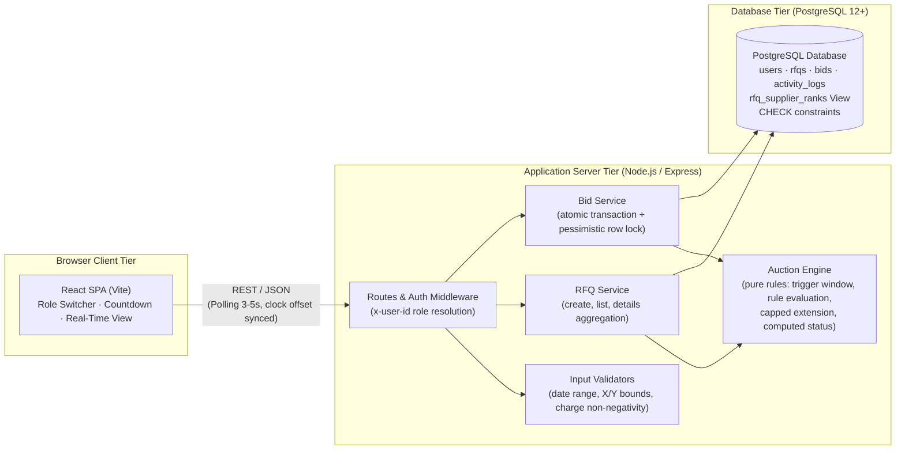
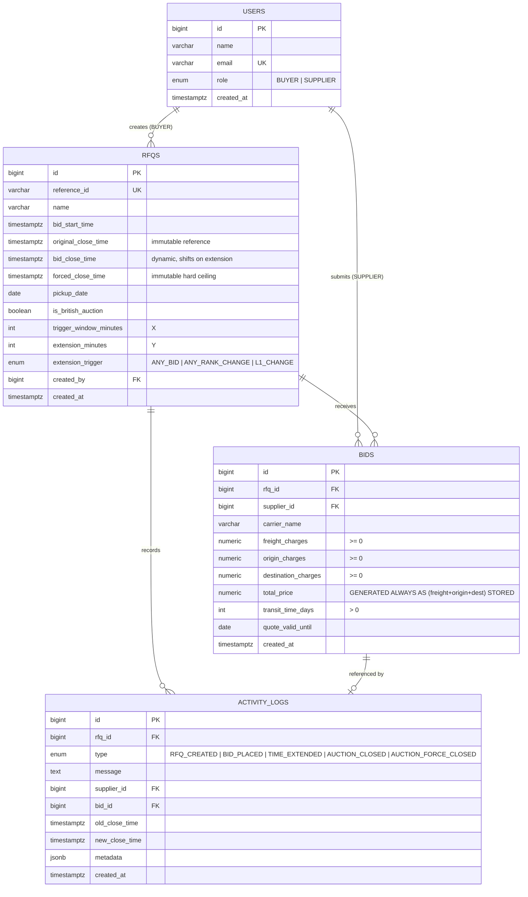
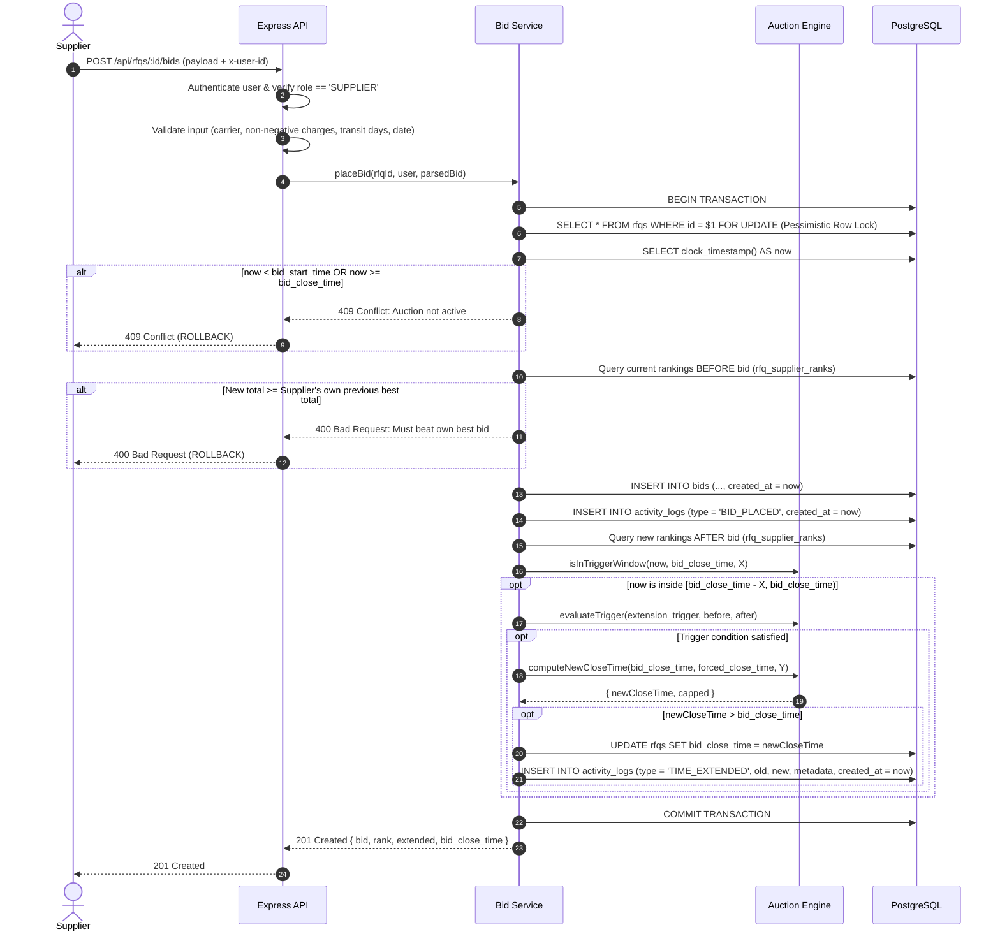
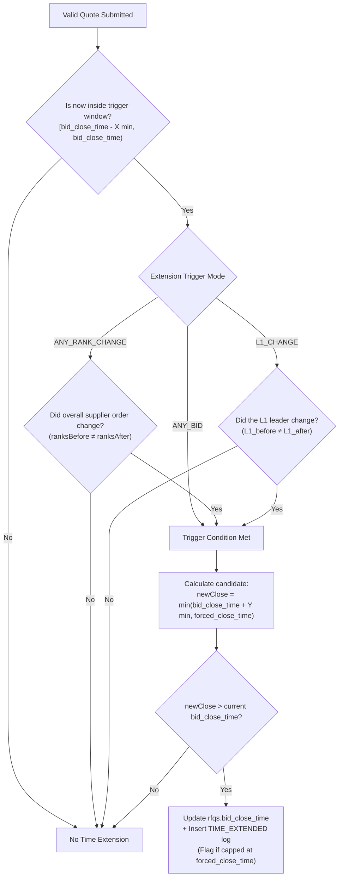
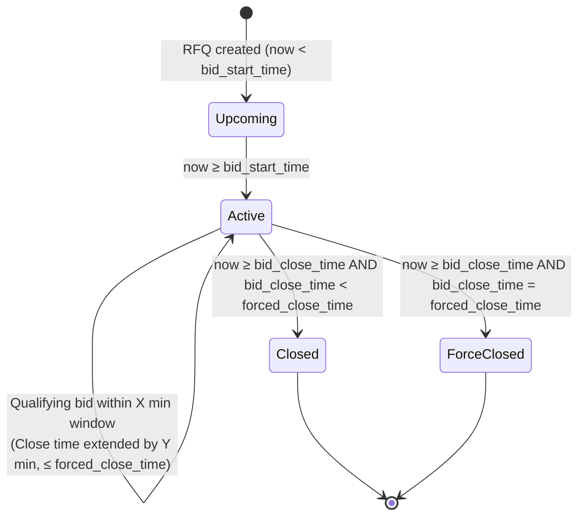

# British Auction RFQ System: High-Level Design (HLD)

## 1. Overview

A full-stack web application where a buyer creates a Request for Quotation (RFQ) configured with British Reverse Auction rules. Suppliers submit quotes openly, competing by progressively lowering their prices to beat competitors. 

If qualifying bidding activity occurs in the last **X minutes** (the trigger window) before close, the auction close time automatically extends by **Y minutes**, capped strictly at a **Forced Close Time** beyond which bidding cannot continue under any circumstances.

### Primary Objectives & Business Goals
- **Transparent & Fair Supplier Competition:** Full visibility into competitive quotes and supplier ranks ($L1, L2, L3, \dots$).
- **Anti-Sniping Defense:** Eliminates last-second bid sniping manipulation by extending the auction window whenever competitive bids occur near deadline.
- **Maximized Buyer Savings:** Drives supplier prices down in a reverse auction dynamic.
- **Complete Audit Provenance:** Every bid and extension event is logged with human-readable explanations and structured metadata.

---

## 2. Architecture

### Component Responsibilities

| Component | Responsibility |
|---|---|
| **React SPA** | Interactive UI containing RFQ Listing, RFQ Creation form with instant validation, live Auction Details (synchronized countdown timer, dynamic supplier ranking table, bid form, and real-time activity log timeline). Includes a demo role switcher. |
| **Routes & Auth** | Maps endpoints to services and verifies user roles (`BUYER` vs `SUPPLIER`) via the `x-user-id` header. |
| **Validators** | Defensive input validation enforcing business bounds (dates, positive integers for $X$ and $Y$, valid triggers, non-negative monetary figures). |
| **RFQ Service** | Handles RFQ creation, listing queries with lowest bid aggregation, and detail payloads including ranks and activity logs. |
| **Bid Service** | Executes the entire quote submission flow inside an atomic database transaction guarded by a pessimistic row lock (`SELECT FOR UPDATE`). |
| **Auction Engine** | Pure, side-effect-free mathematical and logical functions: trigger window detection, trigger rule evaluation (`ANY_BID`, `ANY_RANK_CHANGE`, `L1_CHANGE`), capped extension calculation, and state machine status calculation. Fully unit-tested. |
| **PostgreSQL Database** | ACID-compliant persistent store. Enforces database-level constraints as the final safety barrier and provides a generated stored column for quote total prices. |

---

## 3. Data Model & Entity Relationships

### Key Schema Design Decisions
1. **`original_close_time` vs `bid_close_time`:** `original_close_time` is immutable, allowing the UI and audit logs to display the baseline closing window alongside extensions.
2. **Database Constraint Defense:** `CHECK (bid_close_time <= forced_close_time)` ensures the database engine rejects any extension attempt beyond the hard cap, regardless of application logic bugs.
3. **Generated Stored Column for Total Price:** Total price is computed by the database engine (`freight + origin + destination`), eliminating float rounding errors and charge-to-total drift.
4. **Append-Only Bids Table:** All historical bids are retained for procurement auditing. Ranking is dynamically calculated on each supplier's best quote.
5. **Deterministic Tie-Breaking:** Ties are broken chronologically: `ORDER BY total_price ASC, created_at ASC, bid_id ASC` (earliest bid wins the tie).

---

## 4. Core Flow: Bid Submission & Extension Evaluation

---

## 5. Extension Decision Tree

---

## 6. Auction State Machine & Lifecycle

Status is calculated on read from timestamps and never stored, eliminating synchronization lag and scheduled background workers:

| Status | Condition | Meaning |
|---|---|---|
| **`UPCOMING`** | `now < bid_start_time` | Auction scheduled; bids not yet accepted. |
| **`ACTIVE`** | `now >= bid_start_time AND now < bid_close_time` | Auction is open for live bidding and extensions. |
| **`CLOSED`** | `now >= bid_close_time AND bid_close_time < forced_close_time` | Auction closed naturally after bidding activity subsided. |
| **`FORCE_CLOSED`** | `now >= bid_close_time AND bid_close_time = forced_close_time` | Auction reached the maximum forced close ceiling; extensions exhausted. |

---

## 7. Concurrency & Consistency Strategy

1. **Pessimistic Row-Level Lock (`FOR UPDATE`):**
   - At the beginning of the bid placement transaction, the RFQ row is locked via `SELECT * FROM rfqs WHERE id = $1 FOR UPDATE`.
   - Concurrent bids on the same RFQ are processed serially. This guarantees that `ranksBefore`, bid insertion, `ranksAfter`, and `bid_close_time` extensions are atomic and consistent.
   - Bids on distinct RFQs run entirely in parallel without contention.
2. **Accurate Clock Synchronization (`clock_timestamp()`):**
   - PostgreSQL's `now()` returns the transaction's *start* timestamp. If a transaction waits on a lock, `now()` would be stale.
   - The application explicitly queries `SELECT clock_timestamp() AS now` after acquiring the lock, ensuring real-time window checks and synchronized audit log timestamps.
3. **Database Constraints as Last Line of Defense:**
   - Database checks (`chk_current_close_in_range`) prevent any write that would push `bid_close_time` beyond `forced_close_time`.

---

## 8. REST API Specification

| Method | Endpoint | Access | Description |
|---|---|---|---|
| `GET` | `/api/users` | Public | Returns all users for the role switcher demo. |
| `POST` | `/api/rfqs` | `BUYER` | Creates a new RFQ with British Auction configurations. |
| `GET` | `/api/rfqs` | Authenticated | Lists all British Auctions with computed status, lowest bid, and closing times. |
| `GET` | `/api/rfqs/:id` | Authenticated | Retrieves detailed RFQ information: ranking table, all bids, activity log, and `server_time`. |
| `POST` | `/api/rfqs/:id/bids` | `SUPPLIER` | Submits a supplier quote and evaluates British Auction extension rules under lock. |

---

## 9. Assumptions & Domain Rules

| # | Topic | Decision & Rationale |
|---|---|---|
| 1 | **Extension Base** | The extension duration $Y$ is added to the **current close time** ($T_{\text{new}} = T_{\text{close}} + Y$), not to current time, honoring standard British Auction rules. |
| 2 | **Sliding Window** | When an extension occurs, the trigger window dynamically slides: $[T_{\text{new}} - X, T_{\text{new}})$. Subsequent bids inside the shifted window can trigger further extensions. |
| 3 | **Capped Extensions** | $T_{\text{new}} = \min(T_{\text{close}} + Y, T_{\text{forced}})$. Once an auction hits $T_{\text{forced}}$, no further extensions occur. |
| 4 | **Own-Best Improvement** | In a reverse auction, a supplier must submit a total price lower than their own previous best quote. |
| 5 | **Rank Change Semantics** | Under `L1_CHANGE`, extension occurs only when a different supplier takes the $L1$ position. If the reigning $L1$ lowers their own quote, their rank did not change, so it does not trigger an extension. Under `ANY_RANK_CHANGE`, any shift in the supplier leaderboard triggers an extension. |
| 6 | **Clock Offset Sync** | The client computes `offsetMs = server_time - client_time` so client-side countdown timers remain accurate regardless of local system clock skew. |
