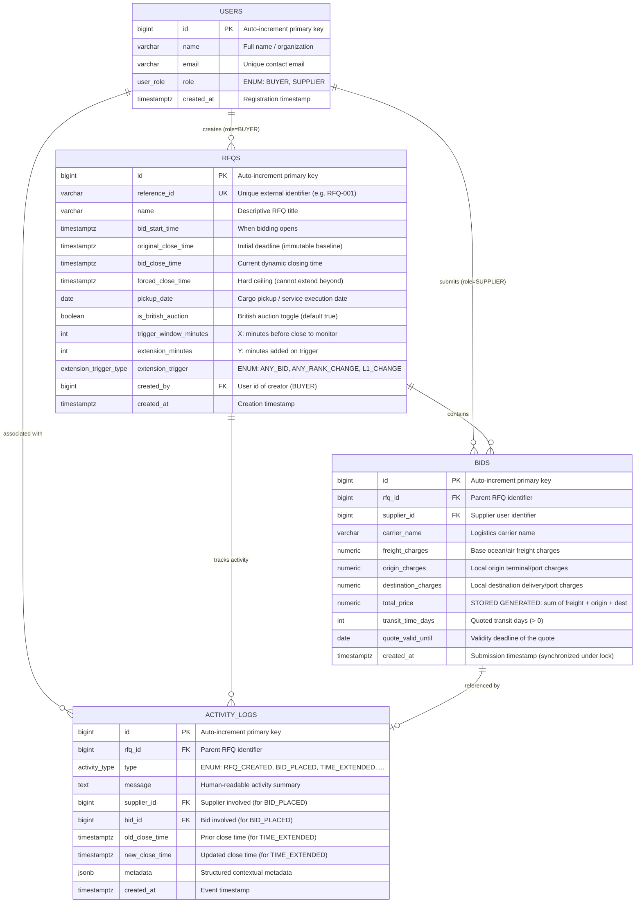

# British Auction RFQ System: Database Schema Design

This document describes the PostgreSQL database schema for the British Auction RFQ system.

---

## 1. Entity-Relationship (ER) Diagram



---

## 2. Table Specifications & Data Dictionary

### 2.1 `users` Table
Stores buyer and supplier credentials and identities for role enforcement.

| Column | Type | Constraints | Description |
|---|---|---|---|
| `id` | `BIGSERIAL` | `PRIMARY KEY` | Unique internal user ID. |
| `name` | `VARCHAR(120)` | `NOT NULL` | Display name of the user or company. |
| `email` | `VARCHAR(255)` | `UNIQUE` | Contact email address. |
| `role` | `user_role` (ENUM) | `NOT NULL` | Role: `'BUYER'` or `'SUPPLIER'`. |
| `created_at` | `TIMESTAMPTZ` | `NOT NULL DEFAULT now()` | Timestamp of account creation. |

---

### 2.2 `rfqs` Table
Stores procurement RFQ details, timing parameters, and British Auction configurations.

| Column | Type | Constraints | Description |
|---|---|---|---|
| `id` | `BIGSERIAL` | `PRIMARY KEY` | Unique internal RFQ ID. |
| `reference_id` | `VARCHAR(50)` | `NOT NULL UNIQUE` | Business reference identifier (e.g., `RFQ-001`). |
| `name` | `VARCHAR(200)` | `NOT NULL` | Description of cargo/service required. |
| `bid_start_time` | `TIMESTAMPTZ` | `NOT NULL` | When suppliers can begin submitting quotes. |
| `original_close_time` | `TIMESTAMPTZ` | `NOT NULL` | Baseline close time (never modified). |
| `bid_close_time` | `TIMESTAMPTZ` | `NOT NULL` | Current active deadline; advances on extension. |
| `forced_close_time` | `TIMESTAMPTZ` | `NOT NULL` | Strict hard limit; auction cannot extend beyond this. |
| `pickup_date` | `DATE` | `NOT NULL` | Service/pickup date. |
| `is_british_auction` | `BOOLEAN` | `NOT NULL DEFAULT true` | Flag denoting British Auction mode. |
| `trigger_window_minutes` | `INT` | `NOT NULL, CHECK (> 0)` | Parameter $X$: monitoring window before close. |
| `extension_minutes` | `INT` | `NOT NULL, CHECK (> 0)` | Parameter $Y$: duration added when extension triggers. |
| `extension_trigger` | `extension_trigger_type` | `NOT NULL` | Rule: `'ANY_BID'`, `'ANY_RANK_CHANGE'`, or `'L1_CHANGE'`. |
| `created_by` | `BIGINT` | `REFERENCES users(id)` | Buyer who created the RFQ. |
| `created_at` | `TIMESTAMPTZ` | `NOT NULL DEFAULT now()` | RFQ creation timestamp. |

#### Database Check Constraints on `rfqs`:
* `chk_close_after_start`: `original_close_time > bid_start_time`
* `chk_forced_after_close`: `forced_close_time > original_close_time`
* `chk_current_close_in_range`: `bid_close_time >= original_close_time AND bid_close_time <= forced_close_time`
* `chk_x_positive`: `trigger_window_minutes > 0`
* `chk_y_positive`: `extension_minutes > 0`

---

### 2.3 `bids` Table
Stores all submitted supplier quotes. Maintained as an append-only ledger for complete auditability.

| Column | Type | Constraints | Description |
|---|---|---|---|
| `id` | `BIGSERIAL` | `PRIMARY KEY` | Unique internal bid ID. |
| `rfq_id` | `BIGINT` | `REFERENCES rfqs(id) ON DELETE CASCADE` | Associated RFQ. |
| `supplier_id` | `BIGINT` | `REFERENCES users(id)` | Quoting supplier. |
| `carrier_name` | `VARCHAR(150)` | `NOT NULL` | Nominated carrier (e.g. Maersk, MSC, DHL). |
| `freight_charges` | `NUMERIC(14,2)` | `NOT NULL, CHECK (>= 0)` | Main transit freight charge. |
| `origin_charges` | `NUMERIC(14,2)` | `NOT NULL, CHECK (>= 0)` | Origin terminal handling / documentation. |
| `destination_charges` | `NUMERIC(14,2)` | `NOT NULL, CHECK (>= 0)` | Destination clearance / terminal fees. |
| `total_price` | `NUMERIC(14,2)` | `GENERATED ALWAYS AS (freight + origin + dest) STORED` | Auto-calculated total quote price. |
| `transit_time_days` | `INT` | `NOT NULL, CHECK (> 0)` | Estimated transit duration in days. |
| `quote_valid_until` | `DATE` | `NOT NULL` | Expiration date of the quote validity. |
| `created_at` | `TIMESTAMPTZ` | `NOT NULL` | Exact placement timestamp under row lock. |

#### Indices on `bids`:
* `idx_bids_rfq_price`: `(rfq_id, total_price)` — accelerates ranking and lowest-bid lookups.
* `idx_bids_rfq_supplier`: `(rfq_id, supplier_id, total_price)` — speeds up checking supplier's personal best bid.
* `idx_bids_rfq_created`: `(rfq_id, created_at)` — maintains chronological order.

---

### 2.4 `activity_logs` Table
Maintains the timeline of all auction events, extensions, and bidding actions.

| Column | Type | Constraints | Description |
|---|---|---|---|
| `id` | `BIGSERIAL` | `PRIMARY KEY` | Unique log entry ID. |
| `rfq_id` | `BIGINT` | `REFERENCES rfqs(id) ON DELETE CASCADE` | Associated RFQ. |
| `type` | `activity_type` | `NOT NULL` | Event type: `'RFQ_CREATED'`, `'BID_PLACED'`, `'TIME_EXTENDED'`, etc. |
| `message` | `TEXT` | `NOT NULL` | Human-readable explanation shown in the UI. |
| `supplier_id` | `BIGINT` | `REFERENCES users(id)` | Associated supplier (optional). |
| `bid_id` | `BIGINT` | `REFERENCES bids(id)` | Associated bid ID (optional). |
| `old_close_time` | `TIMESTAMPTZ` | Nullable | Close time prior to extension. |
| `new_close_time` | `TIMESTAMPTZ` | Nullable | Extended close time. |
| `metadata` | `JSONB` | Nullable | Structured JSON metadata (e.g. trigger type, L1 supplier before/after, capped flag). |
| `created_at` | `TIMESTAMPTZ` | `NOT NULL DEFAULT now()` | Event timestamp. |

---

## 3. Dynamic Supplier Ranking View (`rfq_supplier_ranks`)

In reverse auctions, each supplier is represented on the leaderboard by their **best (lowest) quote**. Ties are broken deterministically by submission timestamp (`created_at ASC`).

```sql
CREATE VIEW rfq_supplier_ranks AS
WITH best_bids AS (
  SELECT DISTINCT ON (rfq_id, supplier_id)
         rfq_id, supplier_id, id AS bid_id, total_price, created_at
  FROM bids
  ORDER BY rfq_id, supplier_id, total_price ASC, created_at ASC, id ASC
)
SELECT rfq_id,
       supplier_id,
       bid_id,
       total_price,
       created_at,
       ROW_NUMBER() OVER (
         PARTITION BY rfq_id
         ORDER BY total_price ASC, created_at ASC, bid_id ASC
       ) AS rank          -- 1 = L1, 2 = L2, 3 = L3...
FROM best_bids;
```

---

## 4. Key Queries

### 4.1 Auction Listing Query (with Lowest Bid & Computed Status)
```sql
SELECT r.id,
       r.reference_id,
       r.name,
       r.bid_start_time,
       r.original_close_time,
       r.bid_close_time,
       r.forced_close_time,
       (SELECT MIN(total_price) FROM bids b WHERE b.rfq_id = r.id) AS current_lowest_bid,
       CASE
         WHEN now() < r.bid_start_time THEN 'UPCOMING'
         WHEN now() < r.bid_close_time THEN 'ACTIVE'
         WHEN r.bid_close_time = r.forced_close_time THEN 'FORCE_CLOSED'
         ELSE 'CLOSED'
       END AS status
FROM rfqs r
WHERE r.is_british_auction
ORDER BY r.created_at DESC;
```

### 4.2 Details Query (All Bids with Supplier Rank Badge)
```sql
SELECT b.id, b.supplier_id, u.name AS supplier_name, b.carrier_name,
       b.freight_charges, b.origin_charges, b.destination_charges, b.total_price,
       b.transit_time_days, b.quote_valid_until, b.created_at,
       rk.rank::int AS rank
FROM bids b
JOIN users u ON u.id = b.supplier_id
LEFT JOIN rfq_supplier_ranks rk ON rk.bid_id = b.id
WHERE b.rfq_id = $1
ORDER BY b.total_price ASC, b.created_at ASC;
```
